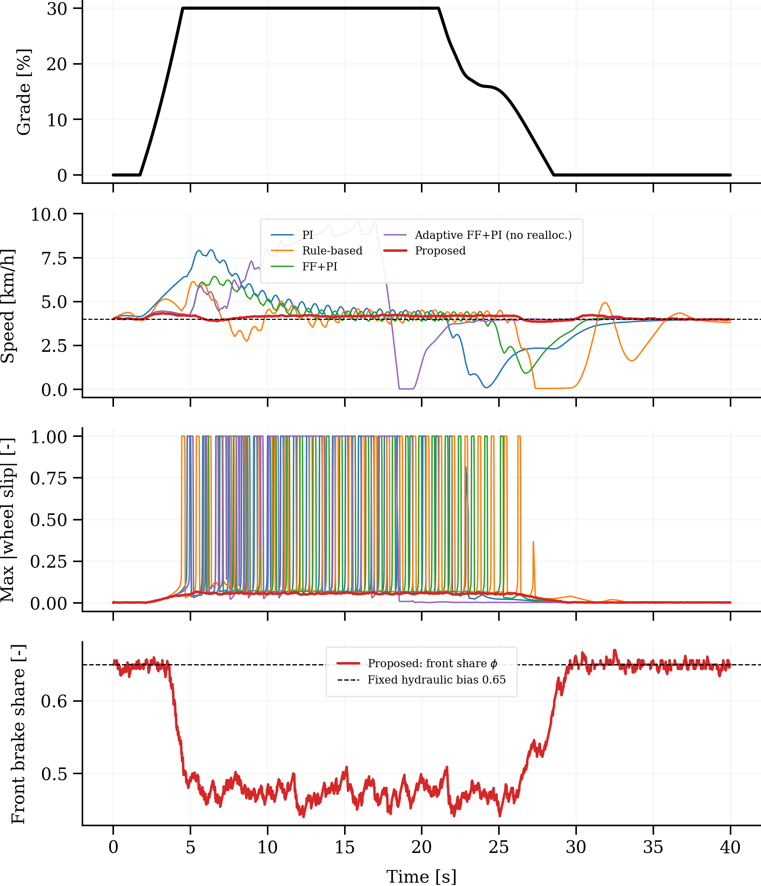

# Direction-Aware, Slip-Aware Brake-Only Speed Limiting

[](LICENSE)


Simulation code and results for the paper:

> H. C. Mudduluru, *Direction-Aware, Slip-Aware Brake-Only Speed Limiting for Low-Speed Descent of Steep Grades with Adaptive Grade and Mass Estimation*. Submitted to the International Journal of Automotive Technology (IJAT).

The code simulates a vehicle that holds a walking-pace set speed (4 km/h) on steep grades using the friction brakes alone. It compares a proposed controller with four baselines in **forward** descent (nose downhill) and **reverse** descent (nose uphill).

**Main finding.** In reverse descent, load shifts to the rear axle while a fixed front-biased brake distribution still asks the front axle for most of the braking force. The front wheels lock and the speed runs away, even with an anti-lock-style slip cap. A slip-aware, direction-scheduled front/rear pressure reallocation removes these lock-ups.



## Repository contents

| Path | Contents |
|---|---|
| `bsl_sim3.py` | Vehicle plant, all controllers, slip layer, Monte Carlo sampling (NumPy only) |
| `run_lib.py` | Performance metrics |
| `run_v4.py` | Reallocation-threshold study on the evaluation set → `out_v4/` |
| `run_reverse_baselines.py` | Reverse-descent PI, RB and A-FF+PI on the evaluation set → `out_paper/mc_*_rev_*.csv` |
| `run_extra.py` | Forward baselines, tuning set and independent validation set → `out_extra/` |
| `make_tables.py` | Builds Tables 2–6 and the friction-margin checks → `tables/` |
| `figs_paper.py`, `fig4.py`, `fig_fix.py` | Figures 1–4 → `out_paper/` |
| `out_v4/` | Evaluation-set results: proposed controller at three reallocation thresholds, FF+PI reverse, parameter samples |
| `out_paper/` | Paper figures and reverse-descent baseline results |
| `out_extra/` | Forward baselines, tuning set and validation set results |
| `paper/` | Script used to build the first manuscript draft (docx-js) |

## Controller names in the code

| Name in code | Name in paper | Description |
|---|---|---|
| `PI` | PI | Feedback-only PI, nominal mass |
| `RB` | RB | Generic rule-based pressure ramp with dead band (not a reproduction of any production system) |
| `FFPI` | FF+PI | PI + grade feedforward (fixed 0.15 s low-pass), nominal mass |
| `PROP1` | A-FF+PI | FF+PI + RLS effective-mass adaptation + jerk limiter, no reallocation (first design iteration) |
| `PROP2` | — | Intermediate design iteration; not reported separately |
| `PROP3` | Proposed | Noise-adaptive Kalman grade estimator, confidence-blended RLS effective mass, feedforward–PI with pressure-command hysteresis, slip-aware front/rear reallocation |

**Paper settings for `PROP3`:** call `simulate(..., Qg=0.15, db=1.0)` and set the reallocation threshold with `bsl_sim3.SLIP['re']` (0.06 forward, 0.04 reverse). The function defaults (`Qg=0.6`, `db=0`) are the earlier design iteration. All controllers share the same PI gains and the same anti-lock-style slip cap.

## Installation

Python 3.9 or later.

```bash
git clone https://github.com/HemanthMChakravarthy/brake-only-speed-limiter.git
cd brake-only-speed-limiter
pip install -r requirements.txt
```

## Reproducing the paper

All result CSVs are included, so the tables can be rebuilt in seconds without rerunning the simulations:

```bash
python make_tables.py
```

To regenerate the results from scratch, delete the result CSVs and run the scripts below. Each skips jobs whose output already exists. Times are for one CPU core.

| Step | Command | Output | Time |
|---|---|---|---|
| 1 | `python run_v4.py` | `out_v4/` | about 6 min |
| 2 | `python run_reverse_baselines.py` | `out_paper/mc_*_rev_*.csv` | about 5 min |
| 3 | `python run_extra.py` | `out_extra/` | about 15 min |
| 4 | `python make_tables.py` | `tables/` | seconds |
| 5 | `python figs_paper.py`, `python fig4.py`, `python fig_fix.py` | `out_paper/*.png` | about 2 min |

Use the simulator directly:

```python
import numpy as np
import bsl_sim3 as S
from run_lib import metrics

prm = S.sample_params(10, np.random.default_rng(0))   # 10 random vehicles / grades / friction levels
S.SLIP['re'] = 0.04                                    # reverse-descent reallocation threshold
rec = S.simulate('PROP3', prm, direction=-1, Qg=0.15, db=1.0)
print(metrics(rec)['max_speed_kph'])
```

## Mapping to the paper

| Paper | Source data | Built by |
|---|---|---|
| Table 2 (reverse) | `out_paper/mc_{PI,RB,PROP1}_rev_*.csv`, `out_v4/mc_FFPI_rena_rev.csv`, `out_v4/mc_PROP3_re0.04_rev.csv` | `make_tables.py` |
| Table 3 (forward) | `out_extra/forward/*.csv`, `out_v4/mc_PROP3_re0.06_fwd.csv` | `make_tables.py` |
| Table 4 (threshold) | `out_v4/mc_PROP3_re*.csv` | `make_tables.py` |
| Table 5 (tuning) | `out_extra/tuning/*.csv` | `make_tables.py` |
| Table 6 (validation) | `out_extra/validation/*.csv` | `make_tables.py` |
| Section 5.4 friction-margin checks | `out_v4/` | `make_tables.py` → `tables/checks.txt` |
| Figure 1 | — | `fig_fix.py` → `out_paper/fig1_architecture.png` |
| Figure 2 | simulated on the fly | `figs_paper.py` → `out_paper/fig3_reverse_lowmu_timeseries.png` |
| Figure 3 | Table 2 data | `fig4.py` → `out_paper/fig4_mc_reverse.png` |
| Figure 4 | `out_v4/` | `fig_fix.py` → `out_paper/fig5_threshold_margin.png` |

The figure file numbers differ from the paper's figure numbers because they come from earlier drafts.

## Data sets

| Set | Parameter seed | Sensor-noise seed | N (feasible) | Used for |
|---|---|---|---|---|
| Tuning | 3 | 7 | 120 | Estimator bandwidth Qg and hysteresis band |
| Evaluation | 42 | 7 | 400 (393) | Main results (Tables 2–5); reallocation-threshold selection |
| Validation | 2027 | 11 | 400 (393) | Independent confirmation (Table 6); not used for any design choice |

Samples with a static friction margin μ cos θ / sin θ ≤ 1.05 are excluded as physically unholdable. Reverse-descent PI, RB and A-FF+PI on the evaluation set were run in two batches of 200 samples; the parameter samples are the same as for the other controllers.

## Key results

Reverse descent, evaluation set, mean (95th percentile):

| Controller | RMS speed error [km/h] | Max speed [km/h] | Runs with wheel lock > 0.5 s |
|---|---|---|---|
| PI | 0.97 (2.33) | 6.76 (10.29) | 63 |
| RB | 1.19 (3.32) | 6.18 (9.06) | 95 |
| FF+PI | 0.49 (1.51) | 5.41 (8.05) | 71 |
| A-FF+PI | 0.42 (0.82) | 5.32 (6.65) | 71 |
| **Proposed** | **0.16 (0.25)** | **4.47 (4.82)** | **0** |

Independent validation set, reverse descent:

| Controller | RMS speed error [km/h] | Max speed p95 [km/h] | Runs with wheel lock > 0.5 s |
|---|---|---|---|
| Baselines (PI, RB, FF+PI, A-FF+PI) | 0.43–1.21 | 7.04–13.98 | 66–111 |
| Proposed, κre = 0.06 | 0.24 | 4.92 | 8 |
| Proposed, κre = 0.05 | 0.18 | 4.92 | 2 |
| **Proposed, κre = 0.04 (final)** | **0.16** | **4.91** | **0** |

Forward descent (evaluation set): the proposed controller's mean RMS speed error was about 35 % lower than FF+PI (0.16 vs. 0.25 km/h) at a similar pressure activity, with no lock-ups.

## Model summary

| Part | Description |
|---|---|
| Vehicle | Two-axle longitudinal model, quasi-static load transfer, grade profile with optional roughness |
| Wheels and tires | Per-axle rotational dynamics, Pacejka-type longitudinal tire (B = 10, C = 1.65), brake lock possible |
| Powertrain | Low-range idle creep / engine-braking force, saturated |
| Brake actuator | Per axle: dead time + first-order lag + 400 bar/s rate limit; fixed hydraulic front share 0.65 |
| Sensors | Wheel speeds (σ = 0.02 m/s), accelerometer (σ = 0.05 m/s², bias up to ±0.1 m/s²) |
| Rates | Plant 1 ms, controllers 10 ms |

All parameters are generic and textbook-representative. They do not describe any production vehicle or brake system.

## Limitations

- Simulation only. No hardware-in-the-loop or vehicle data.
- Quasi-static load transfer. No pitch, suspension, lateral dynamics, split-μ or steering.
- The slip cap is a generic anti-lock-style limiter, not a production ABS. The speed reference is the largest wheel speed.
- Pressure activity is measured on the command signal. Valve hardware dynamics, noise and wear are not modelled.
- One target speed (4 km/h). Brake thermal fade is not coupled to the brake gain.

## Use of generative AI

Microsoft Copilot was used to help write this code. The author reviewed and verified the code and results.

## Citation

Please cite this repository using [CITATION.cff](CITATION.cff) (GitHub's "Cite this repository" button). Once the paper is published, please cite the paper.

## License

MIT. See [LICENSE](LICENSE).
